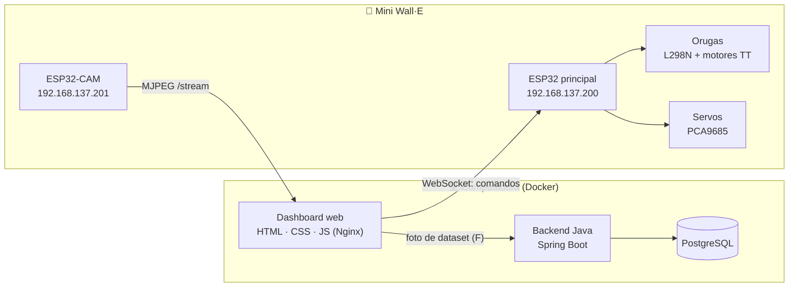

<div align="center">
  

  <h1>🤖 Mini Wall·E</h1>
  <p>
    <strong>Robot de patrulla autónoma con visión artificial y control IoT</strong><br>
    ESP32 · ESP32-CAM · Java · Docker · PostgreSQL
  </p>

  
  
  
  
  
</div>

<br>

## 🧭 Qué es

Mini Wall·E es un robot pequeño con orugas, brazos y compuertas, controlado desde una página web con el teclado. Una **ESP32-CAM** transmite video y sirve de fuente de imágenes para crear un **dataset** con el que se entrena una red neuronal (YOLOv8) para reconocer objetos del entorno.

<table>
  <tr>
    <td width="50%" valign="top">
      <h3>🎮 Control</h3>
      <p>Página web con interfaz tipo mando. Los comandos viajan por <b>WebSocket</b> hasta la ESP32 principal, que mueve motores y servos.</p>
    </td>
    <td width="50%" valign="top">
      <h3>👁️ Visión</h3>
      <p>La ESP32-CAM entrega video MJPEG (<code>/stream</code>) y foto (<code>/capture</code>), pensado para alimentar redes neuronales.</p>
    </td>
  </tr>
  <tr>
    <td width="50%" valign="top">
      <h3>🗄️ Backend</h3>
      <p>Servidor Java (Spring Boot) que guarda las fotos del dataset y las métricas, con PostgreSQL, todo en contenedores Docker.</p>
    </td>
    <td width="50%" valign="top">
      <h3>🧠 IA</h3>
      <p>Etiquetado con LabelImg o Roboflow, entrenamiento con YOLOv8 en Python y exportación a <code>.onnx</code> para integrarlo con el backend.</p>
    </td>
  </tr>
</table>

## 🏗️ Arquitectura



> El robot y la computadora se conectan por el hotspot de Windows (red `192.168.137.x`), con IP fija para cada ESP32.

## 🎮 Controles

| Tecla | Acción |
|:-----:|--------|
| `W` `A` `S` `D` | Mover las orugas (se detiene al soltar la tecla) |
| `Q` / `E` | Cámara arriba / abajo |
| `Z` `X` `C` `V` | Brazos y compuertas |
| `F` | Capturar foto para el dataset |

## 🔩 Hardware

| Componente | Uso |
|------------|-----|
| ESP32 | Cerebro del robot: recibe los comandos por WebSocket |
| ESP32-CAM AI-Thinker | Video MJPEG y fotos del dataset |
| Driver L298N | Controla los motores de las orugas |
| Motores TT 1:48 (100 RPM) | Tracción |
| PCA9685 (I2C) | Controla los servos de brazos, compuertas y cámara |

## 🛠️ Despliegue rápido

```bash
git clone https://github.com/Alfrezy/Mini.Wall-e.git
cd Mini.Wall-e
docker compose up --build -d
```

Después abre el dashboard en tu navegador, enciende el robot y verifica que esté conectado a la misma red.

## 🧠 Entrenar la red neuronal desde cero

1. **Captura:** maneja el robot y pulsa `F` (o el botón en pantalla) para guardar fotos en el dataset.
2. **Etiquetado:** marca las clases (basura, planta, persona) con LabelImg o Roboflow.
3. **Entrenamiento:** entrena con YOLOv8 en Python y exporta los pesos en formato `.onnx`.
4. **Integración:** carga el modelo desde el backend de Java.

## 📄 Licencia

Proyecto bajo licencia MIT. Úsalo, modifícalo y mejóralo.

<div align="center">
  <sub>⭐ Si te gustó el proyecto, deja una estrella.</sub>
</div>