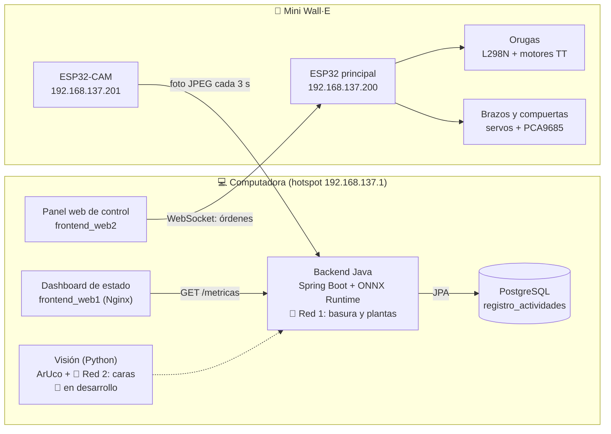

<div align="center">
  

  <h1>🤖 Mini Wall·E</h1>
  <p>
    <strong>Robot de patrulla autónoma con visión artificial y control IoT</strong><br>
    ESP32 · ESP32-CAM · Java · Docker · PostgreSQL
  </p>

  
  
  
  
  
</div>

<br>

## 🧭 Qué es

Mini Wall·E es un robot pequeño con orugas, brazos y compuertas, controlado desde una página web con el teclado. Una **ESP32-CAM** envía una foto cada 3 segundos al backend, que la clasifica con una **red neuronal (CNN en ONNX)** para reconocer cuatro objetos: caja, bota (la planta), bote de aluminio y papel higiénico. El proyecto contempla **dos redes neuronales**: una para la basura y las plantas, y otra para las caras.

<table>
  <tr>
    <td width="50%" valign="top">
      <h3>🎮 Control</h3>
      <p>Página web con interfaz tipo mando. Los comandos viajan por <b>WebSocket</b> hasta la ESP32 principal, que mueve motores y servos.</p>
    </td>
    <td width="50%" valign="top">
      <h3>👁️ Visión</h3>
      <p>La ESP32-CAM toma una foto de 320×240 cada 3 segundos y la envía por HTTP POST al backend para reconocer el objeto.</p>
    </td>
  </tr>
  <tr>
    <td width="50%" valign="top">
      <h3>🗄️ Backend</h3>
      <p>Servidor Java (Spring Boot) que ejecuta el modelo ONNX, lleva el estado del robot, decide las maniobras con marcadores ArUco y guarda cada evento en PostgreSQL. Corre en Docker.</p>
    </td>
    <td width="50%" valign="top">
      <h3>🧠 IA</h3>
      <p>Dos redes neuronales: una CNN que clasifica basura y plantas (96×96 en gris, exportada a <code>.onnx</code>) y otra para reconocer caras, en desarrollo.</p>
    </td>
  </tr>
</table>

## 🏗️ Arquitectura



> El robot y la computadora se conectan por el hotspot de Windows (red `192.168.137.x`), con IP fija para cada ESP32. La línea punteada indica el servicio de visión en Python, que todavía está en desarrollo.

## 🎮 Controles

| Tecla | Acción |
|:-----:|--------|
| `W` `A` `S` `D` | Mover las orugas (se detiene al soltar la tecla) |
| `Z` / `X` | Bajar brazo izquierdo / derecho (vuelven solos al soltar) |
| `C` / `V` | Abrir / cerrar las compuertas |
| `F` | Capturar foto para el dataset |

## 🔩 Hardware

| Componente | Uso |
|------------|-----|
| ESP32 | Cerebro del robot: recibe los comandos por WebSocket |
| ESP32-CAM AI-Thinker | Envía fotos al backend para reconocer objetos |
| Driver L298N | Controla los motores de las orugas |
| Motores TT 1:48 (100 RPM) | Tracción |
| PCA9685 (I2C) | Controla los 4 servos: dos brazos y dos compuertas |

## 🧠 Las dos redes neuronales

| | Red 1: basura y plantas | Red 2: caras |
|---|---|---|
| **Para qué sirve** | Decidir si el objeto que ve el robot es basura o la planta | Reconocer caras de personas |
| **Entrada** | Foto de la ESP32-CAM, 96×96 en escala de grises | Foto de la cámara |
| **Clases** | `Caja`, `bota` (planta), `boteAluminio`, `papelHigienico` | Por definir |
| **Dónde corre** | Backend Java con ONNX Runtime (`MiniWallE.onnx`) | Servicio de visión en Python |
| **Código** | `EntrenamientoNeuronal/` | 🚧 en desarrollo |
| **Estado** | ✅ entrenada y conectada al backend | 🚧 pendiente |

## 🛠️ Despliegue rápido

```bash
git clone https://github.com/Alfrezy/Mini.Wall-e.git
cd Mini.Wall-e
docker compose up --build -d
```

Después abre el dashboard en tu navegador, enciende el robot y verifica que esté conectado a la misma red.

## 🏋️ Entrenar la red de basura y plantas

El entrenamiento está en `EntrenamientoNeuronal/`:

1. **Dataset:** fotos organizadas por clase en `dataset/entrenamiento` y `dataset/validacion` (Caja, bota, boteAluminio, papelHigienico).
2. **Auditoría:** `python3 src/auditar_dataset.py` revisa duplicados y fotos casi iguales.
3. **Entrenamiento:** `python3 src/entrenar.py` entrena la CNN (96×96 en gris) y guarda el modelo en `modelos/`.
4. **Evaluación:** `python3 src/evaluar.py` muestra la matriz de confusión.
5. **Exportación:** se convierte a `MiniWallE.onnx` con `tf2onnx` y el backend lo carga con ONNX Runtime.

## 🗃️ Base de datos

El backend guarda cada detección y cada maniobra en la tabla `registro_actividades` de PostgreSQL (fecha y hora, basura recolectada, plantas plantadas y el evento, por ejemplo `DETECCION_CAJA` o `SIEMBRA_COMPLETA`).

## 🐳 Servicios de Docker

| Servicio | Puerto | Estado |
|----------|:------:|--------|
| `database` (PostgreSQL 15) | 5432 | ✅ activo |
| `backend` (Spring Boot) | 8080 | ✅ activo |
| `frontend` (Nginx, dashboard) | 80 | ✅ activo |
| `ai-engine` (Python, visión) | 5000 | 🚧 comentado hasta terminar el detector |

## 📄 Licencia

Proyecto bajo licencia MIT. Úsalo, modifícalo y mejóralo.

<div align="center">
  <sub>⭐ Si te gustó el proyecto, deja una estrella.</sub>
</div>